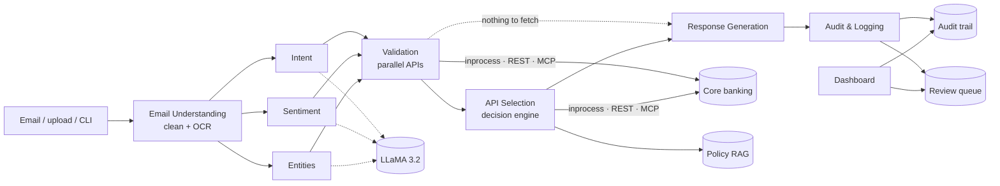

# Intelligent Email Processing & Automated Customer Response System with MCP

**Task 1002.** An agentic AI system that reads banking customer emails and their attachments, detects
every request and the customer's tone, validates details against core banking, calls the right
APIs in parallel, and replies with one professional, PII-masked email. It includes an Operations
dashboard to monitor and control all of this live.

**Stack:** Python · LangGraph (8 agents) · LLaMA 3.2 via Ollama · Model Context Protocol (MCP 2.x) ·
FastAPI · FAISS RAG · Tesseract OCR · Gmail IMAP/SMTP

---

## Quick start

```bash
./setup.sh                      # venv, dependencies, pulls the LLaMA model if Ollama is installed
source .venv/bin/activate
python main.py                  # http://127.0.0.1:8000/dashboard
```

| URL | What |
|---|---|
| `/dashboard` | **Dashboard**: live monitoring + controls |
| `/docs` | Swagger for all REST APIs |

Other entry points:

```bash
python main.py demo-all                         # all 17 scenarios in the terminal
python main.py scenario --key scenario_5_partial_failure --transport mcp
python main.py interactive                      # type your own emails
python main.py evaluate                         # accuracy on 60 labelled emails
python main.py email-worker --poll              # live Gmail channel (needs .env)
python main.py serve-mcp                        # MCP banking server over stdio
pytest                                          # 123 tests, about 10 s (add --llm for live LLaMA parity tests)
docker compose up --build                       # app + Ollama
```

System requirements: Python 3.10+, `tesseract-ocr` (OCR), and [Ollama](https://ollama.com) with
`llama3.2:3b`. Without Ollama the system falls back to its rule engine automatically.

Optional: set `ADMIN_PASSWORD` in `.env` to require a login for the dashboard and control APIs (user `ADMIN_USER`, default `admin`).

---

## The five scenarios from the brief (verbatim inputs)

| # | Customer email | What the system does | Reply (masked) |
|---|---|---|---|
| 1 | *Please provide my savings account balance for account number 1234567890.* | `BALANCE_ENQUIRY` → ValidateAccount → GetAccountBalance | `Account Number: XXXX7890`, `Available Balance: INR 1,25,000.00` |
| 2 | *Please share my last 5 credit card transactions for card 4567XXXX8901.* | `CARD_TRANSACTIONS`, count 5 → ValidateCard → GetCardTransactions | Card `XXXX-XXXX-XXXX-8901` + 5 transactions |
| 3 | *Kindly send my bank statement for April 2026.* | `STATEMENT_REQUEST`, period 2026-04-01 to 2026-04-30. **No account in the email**, so the sender's registered account is used (LookupCustomerByEmail) → GetStatement | Statement reference + secure link |
| 4 | *…balance for account 1234567890 and also send last 3 transactions of my credit card 987654321.* | Two intents → 3 validations in parallel → 2 data APIs in parallel | One consolidated email with both sections |
| 5 | *…balance for account 1234567890 and card transactions for card 999999999.* | Account VALID, card INVALID → balance fetched, card API skipped | "partially processed", balance shown, *"The credit card number provided … could not be validated. Kindly recheck the card details and resend your request."* |

Plus twelve more scenarios for §4.8 error handling, security and the optional enhancements:

| # | Scenario | Result |
|---|---|---|
| 6 | Angry / urgent customer | apology + escalation note, flagged for human review |
| 7 | Missing account number | clarification request |
| 8 | Minimum-balance policy question | policy answer from FAISS RAG |
| 9 | Unsupported request (home loan) | routed to an officer |
| 10 | Core API timeout | retried, then "temporary issue, we'll follow up" |
| 11 | Core API outage | partial success: the card section is still delivered |
| 12 | Account belongs to another registered customer | refused |
| 13 | Image attachment | answered via OCR |
| 14 | Scanned PDF | answered via OCR |
| 15 | Several accounts and cards in one email | each validated and answered separately; the invalid card is flagged |
| 16 | Hindi email | translated by LLaMA, then answered; the reply notes the language |
| 17 | Unregistered sender | no account data shared; asked to write from the registered email |

---

## Architecture



**Design choices worth discussing:**

1. **The LLM understands; the code decides.**
   - LLaMA classifies intent, tone and entities. A deterministic rule layer verifies its output ("grounding").
   - A number that isn't in the email can't reach a core system, and a sentence can't become a name.
   - Rule vetoes stop known confusions: "minimum balance" is a policy question, not a balance request.
2. **The bank's facts are never generated.** Replies are built from verified API data, so balances, transactions and links can't be hallucinated. An LLM-written opening line was tried and measured: even with guardrails, LLaMA wrote false promises ("your balance will be updated shortly"), so it ships switched off.
3. **Partial success per intent.** One invalid card or one API outage only affects its own section of the reply.
4. **Account vs card by context, not position.**
   - "card 999999999 and account 1234567890" works in either order.
   - Phone numbers are ignored.
   - LLaMA on its own mislabelled the card in Scenario 2 as an account, and the rule layer fixes this.
5. **Escalation-biased sentiment.** Missing an angry customer costs more than over-flagging one.
6. **Resilience.**
   - Per-call timeouts, and exponential-backoff retries on transient errors only.
   - "Invalid" (customer must recheck) is kept separate from "unavailable" (our fault).
7. **Security.**
   - Account data only goes to registered senders; the Gmail worker also checks Gmail's SPF/DKIM/DMARC verdict to catch spoofed senders.
   - Optional login for the dashboard and control APIs (one setting); approvals record who approved.
   - PII masking in replies, logs, audit and dashboard, with a leak scanner over the audit store.
   - **Sender ownership check:** you can't get someone else's balance by emailing their account number from your registered email.
   - The holder's name is only shown to a verified sender.
   - Attachment path-traversal protection.
8. **MCP is a real transport.** The same pipeline can call core banking through the MCP server over stdio. Switch it live from the dashboard.
9. **Measured, not claimed.** 60 labelled emails: 93.3% intent accuracy with LLaMA (85% rules-only) and 100% on account/card numbers (`docs/EVALUATION.md`).
10. **Built to keep running.** Queue-based Gmail intake with a worker pool, circuit breaker on core banking, idempotent replies (no double emails), a failed-email list with retry, caching, Prometheus `/metrics`, and per-agent timing for every email.
11. **Extensible.** A new intent is one registry entry plus prompt and rule cues (see `docs/AGENT_WORKFLOW.md`).

---

## Dashboard (`/dashboard`)

Everything on the page comes from processed emails, the approval queue or live health checks.
Nothing is hard-coded.

- **5 KPIs:** emails processed, % answered automatically, average response time, replies waiting for approval, system failures.
- **Emails by outcome** per minute: resolved, partial, needs customer info, sent to officer, system failure.
- **Recent emails.** Click one to see what the agents understood, the validation results, every bank API call, the reply sent, and the step-by-step agent trace.
- **Controls:**
  - run one scenario or all of them
  - switch the core banking connection (direct / REST / MCP)
  - hold flagged replies for approval
  - start / stop the Gmail worker
  - clear data
- **Waiting for approval:** approve (sent via SMTP for real emails) or reject.
- **System health:** live probes of core banking, MCP, Ollama, OCR, policy RAG and the Gmail worker.

Extra operations are available through the API (`/docs`, under "Operations & Control"): fault injection, timeout and retry settings, load testing, audit export.

---

## Interview demo script (about 5 minutes)

1. `python main.py`, then open `/dashboard`. System health shows Ollama, OCR and core banking are live.
2. Click **Run all scenarios**. The KPIs, chart and recent emails fill up.
3. Click the **Partial** row (Scenario 5): account valid, card invalid, balance given, card flagged.
4. Click a **Statement** row (Scenario 3): no account number, so it's found from the registered email.
5. Switch **Core banking connection → MCP**, then run Scenario 4. The email details show `mcp` on each API call.
6. Tick **Hold flagged replies for approval**, then run Scenario 6 (angry customer). It appears under "Waiting for approval": click **Approve**.
7. Run "13. Image Attachment (OCR)": the account and card numbers are read from a PNG form.
8. Optional: start the Gmail worker and email the inbox live.

---

## Project structure

```
agents/          8 agents + intent registry
apis/            mock CBS/CMS, resilient API client, FastAPI server, MCP server + client,
                 operations API, dashboard UI
models/          Pydantic schemas, LLaMA client
prompts/         LLM prompts
workflows/       LangGraph orchestrator
utils/           NLU rules, OCR/document reader, PII masking, RAG, metrics, review queue, logging
config/          settings (env / .env)
tests/           123 tests (+7 live-LLM tests with --llm)
migrations/      Alembic database migrations
docs/            architecture, LLD, API spec, agent workflow, assumptions & limitations
knowledge_base/  bank policy documents for RAG
sample_data/     scenario emails, sample attachments (PNG, scanned PDF, text)
logs/            email_automation.db (SQLite), app.log (gitignored)
main.py · email_worker.py · Dockerfile · docker-compose.yml · setup.sh · .env.example
```

## Configuration

Copy `.env.example` to `.env`. Key settings: `OLLAMA_MODEL`, `BANKING_API_TRANSPORT`, `HITL_ENABLED`,
`REQUIRE_REGISTERED_SENDER`, `DATABASE_URL` (SQLite by default; PostgreSQL in docker-compose), `ADMIN_PASSWORD`,
`EMAIL_USER` / `EMAIL_PASS` (Gmail **app password**), and `DEMO_CUSTOMER_EMAIL`. Set that
to your own Gmail so live emails from you act as fixture customer John Doe. The full list is in `docs/LLD.md` §5.

## Documentation
- [Solution architecture](docs/ARCHITECTURE.md)
- [Low-level design](docs/LLD.md)
- [API specification](docs/API_SPECIFICATION.md)
- [Agent workflow](docs/AGENT_WORKFLOW.md)
- [Assumptions & limitations](docs/ASSUMPTIONS_AND_LIMITATIONS.md)
- [Evaluation results](docs/EVALUATION.md)
