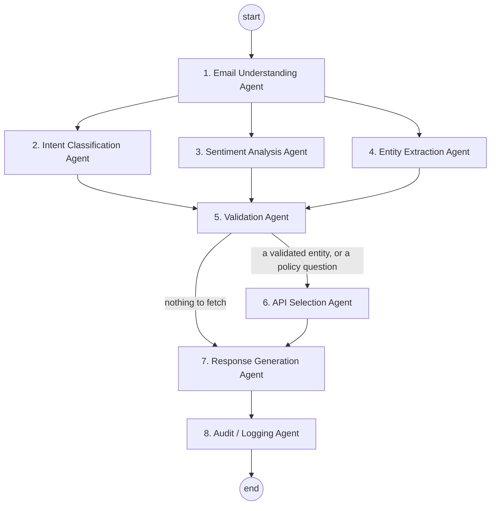
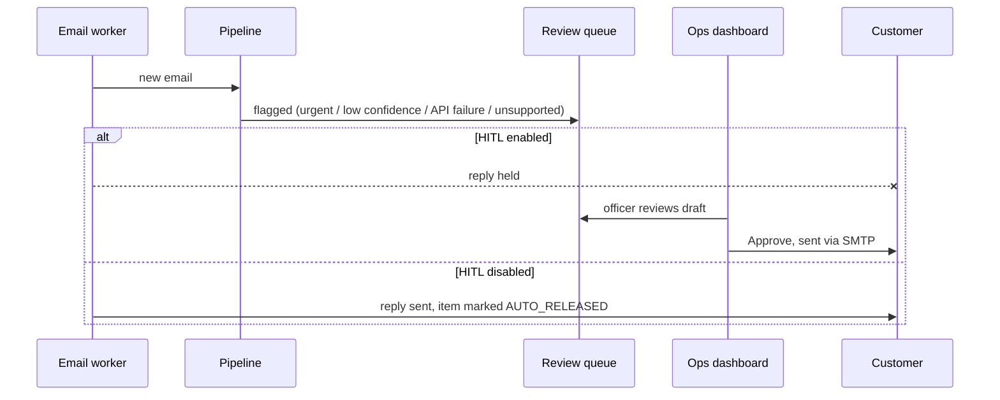

# Agent Workflow

## Graph

Agents 2–4 are independent, so LangGraph runs them as parallel branches of one superstep and joins at
validation. All agents share one typed `AgentState` (`models/schemas.py`).

## Agents

### 1. Email Understanding Agent (`agents/email_agent.py`)
- Strips HTML, signatures, disclaimers and reply chains, and normalises whitespace (`utils/text_cleaner.py`).
- Detects the language (English, Indian scripts, Romanised Hindi) and has LLaMA translate non-English emails to English. The translation is only used if it keeps every number from the original.
- Reads every attachment (`utils/document_reader.py`):
  - **PDF:** the text layer; pages with no text are OCR'd from their embedded images.
  - **Images:** any format Pillow opens (PNG, JPG, TIFF incl. multi-page, BMP, GIF, WEBP), OCR'd with Tesseract.
  - **Text/CSV.**
  - The file type is detected from its content, so a mislabelled scan still works.

### 2. Intent Classification Agent (`agents/intent_agent.py`)
An ensemble of LLaMA and high-precision rule cues:

| LLM | Rules | Result | Confidence |
|---|---|---|---|
| yes | yes | accept | 0.97 |
| no | yes | accept (rules are precise) | 0.80–0.85 |
| yes | no, but a cue word is present | accept | at most 0.70, which triggers review |
| yes | no cue word in text | reject (hallucination) | – |
| yes | vetoed by rules | reject (e.g. "minimum balance" means POLICY, not BALANCE) | – |

Labels the LLM invents (e.g. `HOME_LOAN_APPLICATION`) are dropped. If nothing remains, the result is
`GENERAL_INQUIRY` (an unsupported request).

### 3. Sentiment Analysis Agent (`agents/sentiment_agent.py`)
- Uses its own prompt plus a lexicon (urgent, frustrated, ombudsman, fraud, "!!", and so on).
- **Biased towards escalation:** `NEGATIVE_URGENT` from either the LLM or the lexicon wins, because missing an angry customer costs more than over-flagging one.
- `POSITIVE` requires explicit appreciation in the text, because small models over-call it.

### 4. Entity Extraction Agent (`agents/entity_agent.py`)

| Entity | Method |
|---|---|
| Account / card number | Every number-like token is labelled by the **closest preceding keyword** ("card…", "account / a/c…"). Phone, OTP and reference numbers are ignored. Without a keyword, masked or 16-digit tokens are cards and 9–18 digit tokens are accounts. |
| Transaction count | "last 3", "latest five", "previous 10 transactions". Defaults to 5. |
| Statement period → date range | "April 2026", "04/2026", "January to March 2026", "01/03/2026 to 15/03/2026", "Q1 2026", "FY 2025-26", "last month", "last 3 months". |
| Customer name | Sign-off or self-introduction, validated to look like a name. |

LLM values only fill gaps the rules left, and only if they appear verbatim in the email
(**grounding**) and pass shape checks. This rejects, for example, a whole sentence returned as a name.

### 5. Validation Agent (`agents/validation_agent.py`)
- Works out which entities the detected intents need, from the intent registry.
- **Stage 1a, sender verification:** `LookupCustomerByEmailAPI`. If the sender isn't registered, or failed SPF/DKIM in the Gmail worker, no account or card data is validated or shared (`UNREGISTERED_SENDER`).
- **Stage 1b:** every quoted account and card is validated in **parallel** (`ValidateAccountAPI`, `ValidateCardAPI`), up to 5 of each.
- Status per entity:
  - `VALID`
  - `INVALID` (`NOT_FOUND` or `OWNERSHIP_MISMATCH`)
  - `MISSING`
  - `UNAVAILABLE` (the validation service failed)
- **Registered-account fallback:** a statement request with no account number uses the sender's registered primary account, since statements go to the registered email (Scenario 3). Balance requests still ask for the number.
- Partial failure is judged **per intent**: some intents can be served and some can't.

### 6. API Selection Agent: the decision engine (`agents/api_selection_agent.py`)
- For each intent: picks the API from the registry and binds it to the best validated entity. Otherwise it records a skip with the reason.
- **Sequence:** stage 1 (validation) runs before stage 2 (data fetch). Within each stage, calls are **parallel**.
- `POLICY_INQUIRY` triggers a FAISS search over `knowledge_base/policies/`.
- The plan (stages, mode, APIs, skips) is stored in `state.api_plan` and audited.

### 7. Response Generation Agent (`agents/response_agent.py`)
- Writes one section per intent from verified API data. Amounts use Indian digit grouping (`INR 1,25,000.00`).
- Explains each failure precisely:

  | Failure | Wording |
  |---|---|
  | invalid | "could not be validated. Kindly recheck…" |
  | missing | asks for the detail |
  | not owned by sender | "write from your registered email" |
  | system error | "temporary system issue, we will follow up" |

- The opening line reflects the outcome: successful, partial, unable, or informational.
- Adds an apology and escalation note for `NEGATIVE_URGENT`.
- **Human-review flags:** negative/urgent tone, intent confidence < 0.8, any core API failure, unsupported request.
- Masks PII in the final text.

### 8. Audit / Logging Agent (`agents/audit_agent.py`)
- Saves one masked record per email to the database (`utils/store.py`: SQLite or PostgreSQL). It holds intents and confidences, sentiment, entities and their sources, validations, the API plan, every API call (masked request, status, latency, attempts, transport), the reply, and the agent trace.
- Adds flagged emails to the review queue: `PENDING_APPROVAL` when HITL is on, `AUTO_RELEASED` otherwise.

## Human-in-the-loop flow

## Adding a new intent (e.g. `CHEQUE_BOOK_REQUEST`)
1. Add it to `IntentType` in `models/schemas.py`.
2. Add a line to `INTENT_SYSTEM_PROMPT` and cues in `STRONG_INTENT_CUES` / `WEAK_INTENT_CUES`.
3. Add the mock API (service, REST route, MCP tool) and an `ApiSpec` in `apis/api_client.py`.
4. Register an `IntentHandler` in `agents/intent_registry.py` (title, API, required entity, render function, missing message).

Validation, API selection, response generation, the audit trail and the dashboard pick it up automatically.
