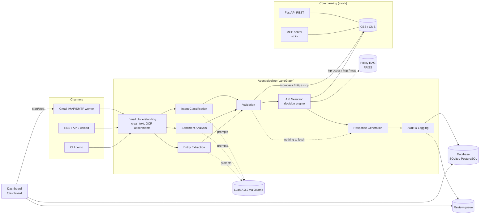

# Solution Architecture

## 1. Goal

Automatically read customer emails (body and attachments), work out every request in them, check the
customer's details against core banking, fetch the data, and reply with one professional, PII-masked
email. Valid requests are always answered, even when other requests in the same email fail.

## 2. High-level view

## 3. Design principles

| Principle | How it shows up |
|---|---|
| **The LLM understands; the code decides** | LLaMA classifies intents, tone and entities. Numbers that reach a core system must be found verbatim in the email ("grounded"), and replies are built only from verified API data, so a balance can never be hallucinated. |
| **Hybrid NLU that degrades gracefully** | A deterministic rule layer runs alongside the LLM. It verifies LLM output, vetoes known confusions ("minimum balance" is a policy question) and is the fallback when Ollama is down, so the pipeline never stops. |
| **Partial success over all-or-nothing** | Each intent is fulfilled on its own. One invalid card or one API outage only affects its own section of the reply. |
| **Fail safe, tell the customer the right thing** | "Invalid / not found" asks the customer to recheck; "system unavailable" says we will follow up; "not your account" asks them to write from their registered email. |
| **Everything is audited and masked** | One database record per email holds every decision and API call, with account and card numbers masked. A PII leak scanner runs over the store. |
| **Extensible by registration** | New intents are added in one registry (`agents/intent_registry.py`), plus a prompt line and rule cues. |

## 4. Components

| Layer | Component | File |
|---|---|---|
| Channels | Gmail worker (IMAP poll, attachment download, SMTP reply, HITL hold) | `email_worker.py` |
| | REST: `/api/v1/process-email`, `/api/v1/process-email-upload` | `apis/banking_api_server.py` |
| | CLI demo / interactive | `main.py` |
| Orchestration | LangGraph `StateGraph` with parallel NLU branches and a conditional route | `workflows/orchestrator.py` |
| Agents | 8 agents (see AGENT_WORKFLOW.md) | `agents/` |
| Intelligence | LLaMA 3.2 client with fallback | `models/llm_client.py` |
| | Rule layer: identifiers, dates, intent cues, sentiment lexicon | `utils/nlu_rules.py` |
| | Policy RAG: TF-IDF + FAISS over policy markdown | `utils/policy_rag.py` |
| | OCR: Tesseract for images and scanned PDFs | `utils/document_reader.py` |
| Integration | Resilient API client (timeout, retry, 3 transports) | `apis/api_client.py` |
| | MCP server (7 tools) and MCP client | `apis/mcp_banking_server.py`, `apis/mcp_client.py` |
| | Mock CBS/CMS with fault injection | `apis/mock_banking_service.py` |
| Operations | Metrics, health probes, control plane, HITL approvals, failed list, Prometheus | `apis/operations.py`, `utils/metrics.py`, `apis/prometheus.py` |
| Quality | Evaluation set and runner | `sample_data/eval_emails.json`, `utils/evaluation.py` |
| Data | Database store and migrations | `utils/store.py`, `migrations/` |
| | Dashboard UI | `apis/dashboard_ui.py` |
| Cross-cutting | PII masking, logging with PII filter, review queue, database store, login | `utils/pii_masker.py`, `utils/logging_config.py`, `utils/review_queue.py`, `utils/store.py`, `apis/auth.py` |

## 5. Request lifecycle (Scenario 5 example)

*"Please provide balance for account 1234567890 and card transactions for card 999999999."*

1. **Email Understanding** cleans the text (signatures, HTML, disclaimers) and OCRs any attachments.
2. **In parallel:**
   - **Intent:** LLaMA and the rules both find `BALANCE_ENQUIRY` and `CARD_TRANSACTIONS`, giving confidence 0.97.
   - **Sentiment:** `NEUTRAL`.
   - **Entities:** account `1234567890` and card `999999999`, each labelled by the keyword in front of it ("account …", "card …"), so their order in the email doesn't matter.
3. **Validation** calls three APIs in parallel: `LookupCustomerByEmailAPI` (sender), `ValidateAccountAPI` and `ValidateCardAPI`. The account is VALID and owned by the sender; the card is INVALID (not found). One intent can be served and one can't, which is a **partial failure**.
4. **API Selection** dispatches `GetAccountBalanceAPI` and records `CARD_TRANSACTIONS` as skipped, with the reason.
5. **Response Generation** writes the balance section, plus a card section asking the customer to recheck the number. The opening line says "partially processed". The output is PII-masked.
6. **Audit** writes the full masked record. If a review were needed, it would also queue the draft.

## 6. Scalability, reliability & quality

**Scalability**
- **Queue-based intake.** The Gmail worker's poller only fetches new emails and puts them on a queue. A pool of `WORKER_CONCURRENCY` worker threads takes emails off the queue and runs the pipeline. Intake and processing scale independently; in production the in-process queue becomes Kafka/SQS and the workers become separate processes or pods.
- **Stateless pipeline.** Each email is processed independently, and all state lives in the database, so workers can be scaled horizontally.
- **Parallelism at two levels.** The three NLU agents run as parallel LangGraph branches. Validation and data-fetch APIs are dispatched concurrently within each stage.
- **Caching.** Validation and customer lookups are cached for `API_CACHE_SECONDS` (60 s), and policy RAG searches are memoised. Data APIs (balances, transactions) are never cached.
- **Model serving.** docker-compose runs Ollama with `OLLAMA_NUM_PARALLEL=4`, so the parallel NLU calls are served concurrently.
- **Measured:** median 2.9 s per email with LLaMA 3.2 3B on a laptop, 8 ms rules-only (see EVALUATION.md). Merging the three LLM calls into one was tested and was slower and less accurate, so it's off by default.

**Reliability**
- **Timeouts and retries.** Per-call timeouts, and exponential-backoff retries on transient errors only.
- **Circuit breaker.** After `CIRCUIT_FAILURE_THRESHOLD` (5) consecutive transient failures, an API fails fast for `CIRCUIT_RESET_SECONDS` (30 s), then lets one trial call through. System health shows open circuits.
- **Idempotency.** Each Gmail `Message-ID` is recorded once answered, so a crash or restart never sends a customer two replies.
- **Dead-letter list.** An email that crashes the pipeline is stored in `failed_emails` with the error and shown on the dashboard with a Retry button, instead of being lost.
- **Graceful LLM fallback.** If Ollama is down or returns bad JSON, the rule engine answers.
- **Schema migrations.** Alembic manages the database schema (`migrations/`), and it's applied automatically on startup.

**Quality and observability**
- **Evaluation set.** 60 labelled emails with `python main.py evaluate`: 93.3% intent accuracy and 100% on identifiers (EVALUATION.md). A regression test protects the baseline.
- **Per-email tracing.** Every email records each agent's start time and duration, shown as a timeline in the dashboard's email details.
- **Prometheus metrics** at `/metrics`: emails by outcome, latency percentiles, SLA compliance, API calls by status, open circuits, LLM fallbacks, review queue, failed list and queue depth.
- **Audit trail.** One masked database record per email with every decision and API call.

**Production roadmap (deliberately not built for this assessment)**
- Async I/O end to end (async LangGraph nodes, async HTTP and MCP clients) for more emails per worker.
- Kafka/SQS instead of the in-process queue; workers as separate deployments with autoscaling on queue depth.
- vLLM/TGI model serving with replicas and a larger model (LLaMA 3.1 8B or 70B).
- OpenTelemetry distributed tracing and Grafana dashboards on top of `/metrics`.

## 7. Security

- Account and card numbers are masked in replies, audit records, app logs and the dashboard.
- **Registered senders only:** account and card data is only shared with senders registered with the bank. The Gmail worker treats a failed SPF/DKIM/DMARC check as unregistered, which stops spoofed `From` addresses.
- **Optional login** on the dashboard and control APIs (HTTP Basic, set `ADMIN_PASSWORD`); approvals record the reviewer.
- **Sender ownership check:** if the sender's email is registered, any account or card they quote must belong to them. This blocks "send me the balance of someone else's account".
- **Name privacy:** the account holder's name is only used in the greeting when the sender is a verified registered customer.
- Attachment safety: downloaded filenames are sanitised (no path traversal), the REST API only reads attachments from allowed folders, and uploads are size-limited.
- Secrets live only in `.env` (gitignored). `.env.example` documents the variables.

## 8. Technology choices

| Need | Choice | Why |
|---|---|---|
| Agent orchestration | LangGraph | Explicit graph, parallel branches, conditional routing, matches the brief |
| LLM | LLaMA 3.2 (3B, Ollama) | Required by the brief; runs locally with no data leaving the machine. 3B chosen over 1B after testing: same English results, but 1B refused to translate the Hindi email |
| Tool protocol | MCP 2.x (official SDK) | Core banking tools exposed to any MCP-capable agent; the pipeline itself can run over it |
| API | FastAPI | Typed contracts (Pydantic), Swagger docs |
| RAG | FAISS + TF-IDF | Small policy corpus; no embedding model needed |
| OCR | Tesseract | Standard, offline, Docker-friendly |
| Store | SQLAlchemy (SQLite default, PostgreSQL via `DATABASE_URL`) | Zero setup locally; docker-compose runs PostgreSQL |
